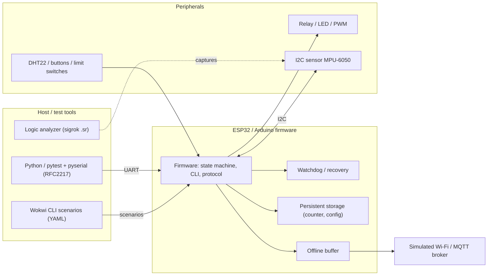

# Embedded QA Portfolio Case Study

**Smart IoT Safety Controller: сім симульованих embedded/IoT збірок, протестованих наскрізно (Tasks 1–7)**
Serhii, QA Embedded Engineer · 2026-10-30

Пов'язані документи: [Master Test Plan](https://claude.ai/artifact/FWePfArKvZnpqF5hUdeUgf) · [Master Test Plan (українська версія)](https://claude.ai/artifact/MZYQ4FPw2Ywuov2Zcb5Qrf) · [Consolidated Bug Report](https://claude.ai/artifact/6KQzyjYGmvvRQ8JC5DY618) · [Evidence Index (українська версія)](EVIDENCE_INDEX_UA.md)

## 1. Project

Case study охоплює сім firmware-збірок, які разом утворюють навчальний продукт Smart IoT Safety Controller. Кожен Task тестував одну збірку в симуляторі (Wokwi) методами black-box. Це окремі збірки, а не один інтегрований пристрій.

| Task | Збірка | Hardware (симульований) | Що робить firmware |
|---|---|---|---|
| 1 | Smart Gate Controller | Arduino Uno, 2 relay, limit switches, 3 кнопки, LED | State machine воріт (CLOSED / OPENING / OPEN / CLOSING / STOPPED / ERROR) з movement timeout 10 с |
| 2 | Button Debounce | ESP32, BUTTON, джерело NOISE, LED | Одна logical event і одна action на натискання, watchdog |
| 3 | UART CLI Homework Device v2.0 | ESP32 | CLI-команди (help, status, set speed, set timeout, led), CONFIG SAVED / DIRTY, ліміт рядка 40 символів |
| 4 | I2C sensor polling | ESP32 + MPU-6050 | Опитування 0x68 приблизно кожні 1.001 с, перемикач FAULT |
| 5 | Recovery / Fault Injection | ESP32 DevKit V1, relay, DHT22 | Deep sleep, task watchdog (4000 мс), persistent counter, powerloss injection |
| 6 | JSON serial protocol | ESP32, LED, PWM-вихід, датчик температури | PING, STATUS, GET TEMP, SET LED, SET PWM (0–100), RESET |
| 7 | IoT network / memory stability | ESP32 + DHT22, симульований MQTT broker | Reconnect із backoff, offline buffer (capacity 8, DROP_OLDEST), STRESS n |

Результат: **36 defects**, жодна збірка не пройшла перевірку, усі not ready для release.

## 2. My QA Goal

Інженерне рішення, яке потрібно було підтримати: **чи можна випускати ці збірки, а якщо ні — що потрібно виправити й повторно перевірити в першу чергу?**

Моя мета — перетворити результати симулятора на рекомендацію, підкріплену evidence: знайти defects, що важливі для safety, data integrity і стабільної довготривалої роботи, довести кожен із них log, trace або результатом тесту, який може перевірити інша людина, і дати пріоритезований список fix та retest замість довгого переліку test cases.

## 3. System Overview

**Interfaces:** UART (CLI і JSON-протокол), I2C (Task 4), GPIO (кнопки, limit switches, NOISE), виходи relay / LED / PWM, симульована мережа (NET DOWN / NET UP).
**Dependencies:** Wokwi 3.7.0 і Wokwi CLI v0.27.1, PlatformIO, Python 3.9.12, pytest 8.4.2, pyserial, capture logic analyzer у форматі sigrok.
**Critical functions:** sensor acquisition, local actuator control, UART і network communication, recovery після faults, збереження критичних даних, safe behavior після abnormal reset, стабільна довготривала робота.

## 4. Critical Risks

У [Master Test Plan](https://claude.ai/artifact/MZYQ4FPw2Ywuov2Zcb5Qrf) визначено 12 Quality Risks. Нижче — пріоритетні (P1) із поясненням, чому вони важливі:

| Risk | Що може піти не так | Чому критично (evidence) |
|---|---|---|
| QR-01 | Обидва relay воріт вмикаються одночасно при реверсі | Реверс без safe stop у 5/5 запусків, перекриття relay у 4/5; може пошкодити драйвер мотора |
| QR-02 | Ворота ніколи не досягають OPEN, помилки не очищаються через RESET | OPEN не досягнуто в 5/5 запусків; цикл limit switch переживає RESET |
| QR-03 | Надто довгий UART-ввід валить пристрій | 26 з 26 спроб понад 40 символів перезавантажили його |
| QR-04 | Перерване збереження пошкоджує persistent counter | Лічильник зростав рівно на 100 після кожного powerloss, нічого не логувалося |
| QR-05 | Повідомлення губляться або дублюються після offline-періоду | Overflow нічого не відкинув, flush повторював і губив ID |
| QR-06 | Витік heap вичерпує пам'ять | 80 B на повідомлення, −23.2% за 1000 повідомлень |

Ризики P2 і P3 (шум приймається як натискання, тиша на I2C після NACK, контракт протоколу, таймінги, reconnect storm, прогалини у вимогах) наведено в плані та в розділі 10.

## 5. Test Strategy

Кожен ризик перетворено на тести з level, method і environment (повний перелік: Test Matrix, розділ 7a плану, 22 тести: 9 × P1, 8 × P2, 5 × P3).

| Risk | Test level | Method | Environment |
|---|---|---|---|
| QR-01, QR-02 | System | Тести state machine і pin-стану relay, послідовності limit switch та RESET | Wokwi, manual (Task 1) |
| QR-03 | Interface / protocol | Boundary-тести на 40, 41, 200, 1000 символів; валідація значень і синтаксису | Wokwi CLI scenarios (Task 3) |
| QR-04, QR-10 | Recovery / fault injection | powerloss під час save, hang, sleep N | pytest + serial (Task 5) |
| QR-05, QR-06, QR-11 | Network | NET DOWN / UP, SEND, STRESS зі слідкуванням за message ID та heap | pytest + serial (Task 7) |
| QR-07 | Component | Sweep ширини імпульсу 0.5–30 мс, шум під час action | Wokwi CLI (Task 2) |
| QR-08 | Interface / protocol | Перемикач FAULT, capture SDA/SCL | Trace logic analyzer (Task 4) |
| QR-09 | Interface / protocol | Валідність JSON, межі PWM, ефект RESET | pytest (Task 6) |

Вибір методів: boundary та negative inputs скрізь, повторні запуски (від 4/5 до 26/26), щоб відрізнити справжні defects від випадкових збоїв, і control-тести, які мають проходити, щоб довести справність harness.

## 6. Key Scenarios

**1. Реверс напрямку воріт (Task 1, safety).** Надіслати O, поки ворота в CLOSING. Expected: CLOSING → STOPPED → OPENING, relay ніколи не HIGH разом. Actual: CLOSING → OPENING напряму; relayOpen (pin 8) стає HIGH за один control-цикл до того, як relayClose (pin 9) стає LOW, тож обидва увімкнені (4/5 запусків). Defects T1-06, T1-09. Evidence: E09.

**2. Sweep ширини імпульсу debounce (Task 2).** Утримувати NOISE low від 0.5 до 30 мс. Expected: імпульси нижче порогу (припущення близько 30 мс) дають 0 events. Actual: 1 мс ігнорується (`Logical events: 0`), імпульс 10 мс дає `Logical events: 1 | Actions: 1`, а 2 мс приймається в 5/5 запусків, тобто ефективний поріг — 1–2 мс. Defect T2-01. Evidence: E01.

**3. Надто довгий UART-рядок (Task 3).** Надіслати рядок у 41 символ. Expected: `ERROR: command too long`. Actual: `*** SYSTEM FAULT ***`, `SW_CPU_RESET`, reboot, далі `ERROR: empty command` (26/26). Defect T3-05. Evidence: E10.

**4. I2C NACK і тиша (Task 4).** Увімкнути FAULT і зняти capture шини. Expected: retry або повідомлення про помилку. Actual: NACK на 0x69 у 609.122546 с, STOP через 14.9 µs, далі жодної активності на шині 33.09 с (близько 33 пропущених циклів опитування). Defects T4-01, T4-02. Evidence: E03.

**5. powerloss під час save (Task 5).** Прочитати counter, надіслати `powerloss`, прочитати знову. Expected: старе значення або old+1, пошкодження залоговано. Actual: counter 8 → 108 та 730 → 831 … 1134 → 1234 (5/5), повідомлення про пошкодження немає. Defect T5-01. Evidence: E05.

**6. Overflow offline buffer і flush (Task 7).** NET DOWN, SEND ×12, NET UP. Expected: buffer=8, dropped=4, кожен із 8 найновіших ID опубліковано один раз. Actual: buffer=12, dropped=0, далі 24 publish: ID 19–22 по чотири рази, 15–18 по два, ID 11–14 жодного разу; 10 × STRESS 100 також коштували 80 004 B heap. Defects T7-03, T7-04, T7-05. Evidence: E07, E08.

## 7. Automation

| Task | Tool | Що автоматизовано | Результат |
|---|---|---|---|
| 2 | Wokwi CLI scenarios + скрипт verdicts | Sweep імпульсів, шум під час action, повтори | 38 рядків verdict: 28 PASS, 7 FAIL, 2 REVIEW, 1 INVALID (TC-24 timed out) |
| 3 | Wokwi CLI scenarios | TC-01…TC-36 з YAML expected output | 36 scenario logs, 5 defects |
| 5 | pytest + pyserial (RFC2217) | Таймінг sleep, watchdog, powerloss, некоректні аргументи | 26 failed, 18 passed, 4 skipped, 1 error (467.53 с) |
| 6 | pytest + pyserial | Валідність JSON, межі PWM, RESET, таймінг PING | 17 failed, 72 passed, 2 skipped, 4 xfailed, 1 error (623.14 с) |
| 7 | pytest + pyserial | Reconnect, buffer, дублікати, heap trend | manual scenarios 5 failed, 16 passed, 1 skipped; recommendations suite 22 failed, 5 passed |

**Чому саме це автоматизовано:** перевірки повторювані, чутливі до часу й потребують багато повторів (sweeps, 10 × STRESS, 26 спроб із довгим рядком), що людина не виконає надійно вручну. Автоматизація також дає однакові кроки для retest після fix.

**Що означають числа:** кількість failed включає setup errors і тести, написані для виявлення підозрілого bug, тому вона не відповідає кількості defects 1:1. Тести, що падають лише через помилку тесту (Task 7 TC-15), не рахувалися як defects. Control-тести (наприклад, дві команди STATUS в одному записі відповідають швидко) проходять, що показує: збої йдуть від firmware, а не від harness.

## 8. Fault Injection

| Fault | Чим введено | Task | Як перевірялися recovery або поведінка |
|---|---|---|---|
| Електричний шум на кнопці | Джерело NOISE, імпульси 0.5–30 мс | 2 | Лічильники Serial Logger (RAW / Logical events / Actions) для кожної ширини |
| Обидва limit switch активні | Вхід у scenario | 1 | Log стану й повідомлень; RESET у ERROR та поза ним |
| Надто довгий і некоректний CLI-ввід | Boundary-рядки, спецсимволи | 3 | Текст відповіді, рядки reboot, незмінена configuration |
| I2C slave NACK | Перемикач FAULT | 4 | Trace logic analyzer: NACK, STOP, тиша на шині, re-init |
| Втрата живлення під час save | Команда `powerloss` | 5 | Counter до і після, повідомлення про пошкодження при старті |
| Зависання firmware | Команда `hang` | 5 | Час до reset, reset reason INT_WDT, нормальний старт після |
| Deep sleep різної тривалості | `sleep N` | 5 | Час wake-up відносно N ±15%, wake cause |
| Збій мережі | NET DOWN / NET UP | 7 | Швидкість retry, backoff, buffer, message ID, дублікати |
| Тиск на пам'ять | STRESS n, повторні цикли reconnect | 7 | Вільна heap до і після |
| Некоректні аргументи команд | sleep, STRESS, SET PWM | 5, 6, 7 | Відповідь-помилка, без мовчазної підміни |

Recovery у кожному випадку оцінювалося за спостережуваним evidence: boot banner, reset reason, значення стану чи counter, timestamp у trace або status JSON-рядок.

## 9. Evidence

Повний індекс зі шляхами до файлів і рядком «як перевірити» для кожного висновку — у [EVIDENCE_INDEX_UA.md](EVIDENCE_INDEX_UA.md) (13 записів, E01–E13).

| Тип evidence | Приклади |
|---|---|
| Logs | Запуски Serial Logger ([E01](../../logs/task2_debounce/bt03_pulse_10ms_run1.log)), UART TC-27 ([E10](../../logs/task3_uart_cli/TC-27.log)), serial log Task 5 ([E04/E05](../../logs/task5_recovery/serial_20261014_152215.log)), device-monitor logs Task 7 ([E06–E08](../../logs/task7_network_memory/device-monitor-261024-174403.log)) |
| Traces | I2C capture [home_work4.sr](../../test-results/i2c_failure.sr) із таблицею таймінгів (E03) |
| Reports | Bug Report xlsx (E09), HTML-звіт Task 3, pytest-sheets Tasks 5–7, [Consolidated Bug Report](https://claude.ai/artifact/6KQzyjYGmvvRQ8JC5DY618) |
| Metrics | Heap −80 004 B (−23.2%), 391 retry за 20 с, watchdog reset на 14.59 с, тиша після NACK 33.09 с |
| Test results | Підсумки pytest та verdicts.md Task 2 ([E02](../../test-results/task6_protocol/pytest_output.txt)) |
| Screenshots | **Gap:** raster-скріншотів Wokwi немає; замість них є PDF-експорти виводу terminal (перелічені в індексі) |

## 10. Findings

| Task | Defects | Severity як зафіксовано | Verdict |
|---|---|---|---|
| 1 | 12 | 5 Blocker, 3 Major, 3 Minor, 1 “Intermittent” | FAIL |
| 2 | 1 | 1 Major | FAIL |
| 3 | 5 | 1 Critical, 4 Major | Not ready for release |
| 4 | 2 | 2 High | FAIL |
| 5 | 5 | 3 Major (High), 2 Medium | NO-GO |
| 6 | 4 | 2 High, 1 Medium, 1 Low/Medium | Неприйнятно, поки BUG-1…3 не виправлено |
| 7 | 7 | 3 Critical, 2 Major, 1 Minor, 1 Trivial | FAIL |
| **Разом** | **36** | | |

Найважливіші findings та їх impact:

1. **Перекриття relay і відсутність safe stop (T1-06, T1-09):** може знищити драйвер мотора; стосується safety.
2. **Ворота не досягають OPEN і не відновлюються (T1-02, T1-03, T1-11):** ворота застрягають; лише power cycle це очищає.
3. **Один довгий UART-рядок перезавантажує пристрій (T3-05):** denial-of-service «випадково».
4. **Counter +100 після powerloss, не виявлено (T5-01):** збереженим даним не можна довіряти.
5. **Overflow buffer, дублікати та втрачені ID, витік heap (T7-03, T7-04, T7-05):** мовчазна втрата даних і зрештою out-of-memory (приблизно після 4300 повідомлень).
6. **RESET відповідає OK, але нічого не змінює, GET TEMP повертає invalid JSON (T6-02, T6-03):** host не може покладатися на протокол.
7. **Порушені контракти таймінгу (T5-02, T5-03, T5-05, T4-01):** wake-up ігнорує N, watchdog спрацьовує за 14.6 с, I2C зупиняється після одного NACK.

Один процесний finding: у Task 1 defect залоговано із severity «Intermittent», а це мітка reproducibility. Severity і reproducibility мають бути окремими полями.

## 11. Regression

Після кожного fix: провалений тест плюс сусідні з початковою кількістю повторів. Після кожної збірки — автоматизований smoke-набір:

- boundary-сценарії Task 3 (40 / 41 / 200 / 1000 символів),
- pytest-suites Task 5 і Task 6,
- STRESS 100 та перевірка flush у Task 7,
- relay-interlock перевірка з Task 1 (20 реверсів, ніколи не HIGH разом).

P1-рядки Test Matrix (TM-01, 02, 03, 04, 06, 08, 09, 10, 11) — release gate для Blocker/Critical defects. Перед release: усі сім suites та один прогін на real hardware для Tasks 1, 4 і 5.

## 12. Limitations

- Усе виконувалось у симуляторах. Таймінги relay, contact bounce, електрична поведінка I2C та brown-out цими результатами не доведені, а команда powerloss — це fault injection, а не справжній brown-out.
- Час береться з simulator clock. Таймінгові знахідки Task 5 (T5-02, T5-03) потребують підтвердження за часом firmware.
- Мережа була моделлю: без реального Wi-Fi, MQTT broker, TLS, latency чи втрат пакетів. SPI не тестувався.
- Частина порогів — мої припущення, а не вимоги (debounce 30 мс, 12 retry за 20 с, 5% втрати heap, ±15% таймінгу). Для I2C recovery і latency PING вимог немає зовсім.
- Task 4 базується на одному capture і не має log firmware; для Task 1 немає raw serial log-файла.
- Не протестовано: стан relay після watchdog reset, збій DHT22, long outage (Task 7 TC-27), watchdog-запуск 300 с (Task 2 TC-24), втрата saved config після crash у Task 3.

## 13. Release / Quality Conclusion

**NO-GO.**

- 36 defects відкриті, усі сім збірок не пройшли або not ready.
- Залишається 9 Blocker/Critical defects (5 у Task 1, 1 у Task 3, 3 у Task 7); Exit Criteria (0 open Blocker/Critical і High defects, 100% запланованих тестів виконано) не виконані.
- Data integrity (T5-01) і коректність протоколу (T6-02, T6-03) також порушені, тому GO WITH RISKS не обґрунтований.
- Переоцінити після виправлення та retest Blocker/Critical і High defects, потім повторити ключові safety- і recovery-тести на real hardware.

## 14. What I Would Improve Next

1. Додати реальні скріншоти Wokwi (circuit diagram, serial monitor, вигляд logic analyzer) до evidence.
2. Повторити T4 з вимкненням FAULT у відомий момент і зняти log firmware, щоб довести або спростувати recovery.
3. Отримати рішення власника вимог щодо open questions: поріг debounce, одиниці PWM, незалежність LED/PWM, latency PING, поведінка I2C recovery.
4. Автоматизувати Tasks 1 і 4 (вони досі manual) і додати relay-interlock перевірку до smoke-набору.
5. Переміряти таймінгові знахідки Task 5 за часом firmware і повторити TM-01, TM-08 та TM-14 на real hardware.
6. Використовувати єдину шкалу severity з reproducibility як окремим полем в усіх майбутніх bug reports.
